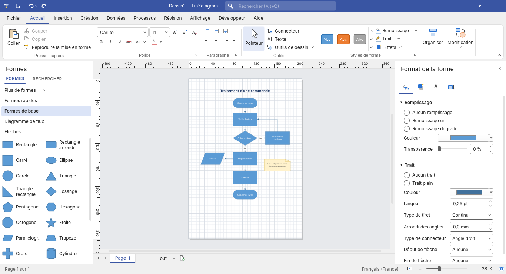
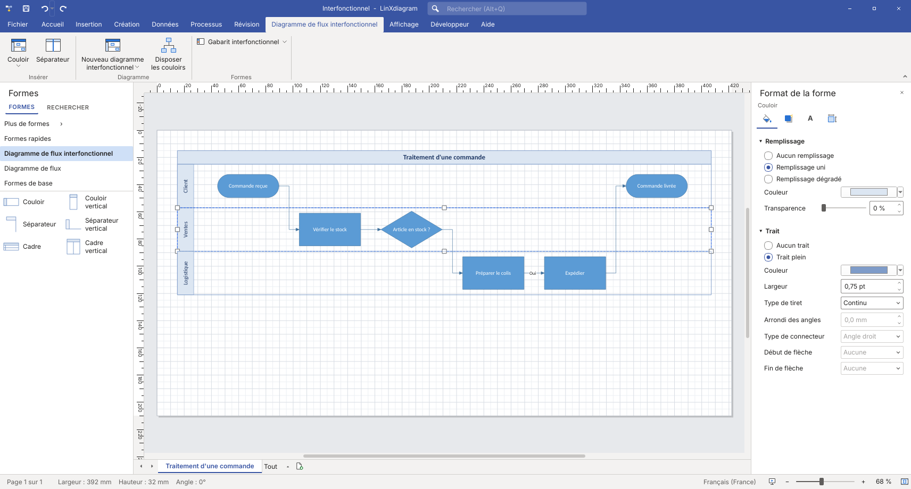
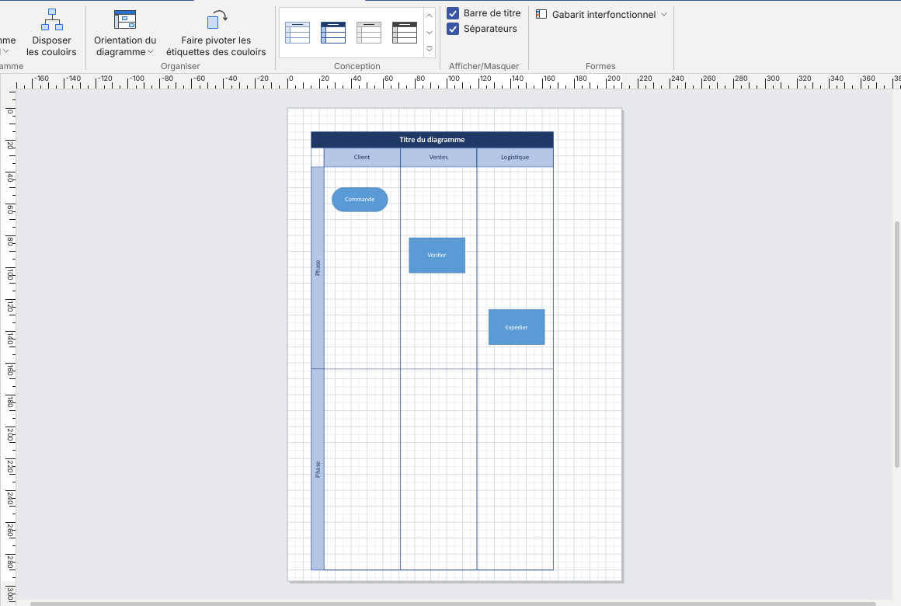

# LinXdiagram

Éditeur de diagrammes **libre et natif pour Linux**, à l'ergonomie familière pour les
habitués de Microsoft Visio : ruban, gabarits de formes, connecteurs dynamiques, connexion
automatique, repères d'alignement… et **compatible avec les fichiers `.vsdx`**.

Application Qt 6 (PyQt6), intégrée au bureau (GNOME, KDE, Wayland et X11).
Site du projet : <https://joss943.github.io/LinXdiagram/>

> Projet indépendant, **non affilié à Microsoft**, ni approuvé ou soutenu par Microsoft.
> Microsoft, Visio et Office sont des marques du groupe Microsoft, citées uniquement pour
> indiquer la compatibilité (voir [THIRD_PARTY_NOTICES.md](THIRD_PARTY_NOTICES.md)).



## Démarrage rapide

```bash
./run.sh                 # lancer depuis les sources
./install.sh             # installer pour l'utilisateur (~/.local), avec entrée de menu
./install.sh --uninstall # désinstaller
```

Dépendances : Python ≥ 3.11 et PyQt6 (`sudo dnf install python3-pyqt6` sur Fedora,
`sudo apt install python3-pyqt6 python3-pyqt6.qtsvg` sur Debian/Ubuntu). La police
Carlito (métriquement identique à Calibri) est utilisée si elle est installée.

## Une interface familière

* **Barre de titre** bleue façon Office : barre d'outils Accès rapide (Enregistrer, Annuler avec
  historique, Rétablir), titre du document et zone **« Rechercher (Alt+Q) »** qui trouve et lance
  n'importe quelle commande ou insère une forme par son nom.
* **Ruban** à neuf onglets : Accueil, Insertion, Création, Données, Processus, Révision, Affichage,
  Développeur, Aide ; grands et petits boutons, boutons partagés, galeries, lanceurs de boîte de
  dialogue ↘, réduction du ruban (Ctrl+F1 ou double-clic sur un onglet).
* **Volet Formes** : onglets FORMES / RECHERCHER, « Plus de formes », Formes rapides, gabarits ouverts,
  liste à deux colonnes, glisser-déposer.
* Gabarits métier de départ : processus **BPMN 2.0**, plan de bureau et schéma électrique, avec leurs
  formes et leurs modèles de document.
* **Volets de tâches** : Format de la forme (Remplissage et trait, Effets, Texte, Taille et
  propriétés), Taille et position, Données de forme, Commentaires, Problèmes, Panoramique et zoom,
  et **Explorateur de dessin** avec recherche et sélection des formes, groupes et connecteurs de la page.
* **Onglets de pages** avec navigation ◀ ▶, menu « Tout » et ⊕ ; **barre d'état** avec page, taille et
  angle de la sélection, langue, mode Présentation et curseur de zoom.
* **Menu Fichier** façon Microsoft 365 : Accueil (« Bonjour », vignettes de modèles, récents),
  Nouveau, Ouvrir, Informations (protection, propriétés), Imprimer avec **aperçu intégré**, Exporter.
* **Menu contextuel avec mini-barre** (police, taille, gras, style rapide, remplissage, trait).
* Thème **« En couleur »** par défaut, thème **Noir** disponible (Fichier > Options).
* La largeur des volets Formes et Format, ainsi que l'état du ruban réduit, sont mémorisés entre
  les sessions. Le canevas ne redessine que les zones modifiées lorsque c'est possible, ce qui
  améliore la réactivité des grands diagrammes.
* La compatibilité et les écarts restants par rapport à Visio sont suivis dans
  [la feuille de route de parité](docs/parite-visio.md).

## Fonctions Visio

| Onglet | Fonctions |
|---|---|
| Accueil | Coller, couper, copier, reproduire la mise en forme ; police, taille, A⁺/A⁻, effacer la mise en forme, gras, italique, souligné, barré, casse ; alignements ; Pointeur, Connecteur, Texte, outils de dessin ; **Styles rapides** (35 styles), Remplissage, Trait (couleur, épaisseur, tirets, flèches), Effets (ombre, lumière, dégradé) ; Aligner, Position, Premier plan, Arrière-plan, Grouper ; **Modifier la forme**, Calques, Sélectionner par type, Rechercher / Remplacer |
| Insertion | Page vierge, dupliquer, renommer, supprimer ; Images ; Conteneur, Légende, Connecteur ; Lien (web ou page du document) ; Zone de texte, Info-bulle d'écran, Symbole |
| Création | Orientation, Taille, **Taille automatique**, Mise en page ; **Thèmes** et **Variantes** ; Arrière-plans, **Bordures et titres** ; **Redisposer la page**, Connecteurs, **sauts de ligne** |
| Données | **Créer à partir de données** (organigramme ou diagramme de flux depuis un CSV), fenêtre Données de forme, **Rapports de forme** (CSV) |
| Processus | **Sous-processus** à partir de la sélection, **Vérifier le diagramme**, fenêtre Problèmes |
| Diagramme de flux interfonctionnel (contextuel) | Couloir (avant / après), Séparateur, nouveau diagramme horizontal ou vertical, Disposer les couloirs, Orientation du diagramme, Faire pivoter les étiquettes, Styles, Barre de titre, Séparateurs |
| Révision | **Commentaires** (nouveau, précédent, suivant, supprimer, volet), **verrouiller les formes**, protéger le document |
| Affichage | **Plein écran** (présentation page par page), règle, grille, grille dynamique, AutoConnect, points de connexion, magnétisme, Zoom, Ajuster à la fenêtre, Largeur de page, Nouvelle fenêtre, Volets des tâches |
| Développeur | ShapeSheet, import / export .vsdx, propriétés du document |

### Diagrammes de flux interfonctionnels (couloirs)



* Modèle **« Diagramme de flux interfonctionnel »** et gabarit dédié : couloirs horizontaux ou
  verticaux, séparateurs de phases, cadre avec barre de titre.
* Onglet contextuel **« Diagramme de flux interfonctionnel »**, affiché dès qu'on utilise des
  couloirs, comme dans Visio : Couloir (avant/après), Séparateur, nouveau diagramme horizontal ou
  vertical, Disposer les couloirs, **Orientation du diagramme** (passe d'horizontal à vertical en
  gardant chaque forme dans son couloir et sa phase, et met la page en portrait ou en paysage),
  **Faire pivoter les étiquettes des couloirs**, galerie de **styles**, cases **Barre de titre** et
  **Séparateurs**.

  
* Comportement de Visio : les couloirs restent accolés ; **glisser un couloir le réordonne et
  emmène ses formes** ; redimensionner un couloir décale les suivants ; insérer un couloir au
  milieu pousse ceux du dessous ; **supprimer un couloir supprime son contenu** et referme
  l'espace ; supprimer le cadre supprime toute la structure ; un nouveau séparateur coupe la phase
  où on le dépose sans rallonger le diagramme ; les nouveaux couloirs reprennent le style de leurs
  voisins. Tout est annulable.
* Étiquettes de couloir verticales, intérieur des couloirs « transparent » aux clics (sélection
  par zone, formes posées dessus).
* **Créer à partir de données** : une colonne « Fonction » dans le CSV produit directement un
  diagramme interfonctionnel, une ligne par fonction, étapes dans l'ordre du processus.
* « Vérifier le diagramme » signale les étapes posées hors de tout couloir.
* Export `.vsdx` : étiquettes verticales comprises, et cadre, couloirs et phases enregistrés comme
  **conteneurs Visio** (`User.msvStructureType`, cellule `Relationships`), avec l'appartenance de
  chaque forme à son couloir et à sa phase. Import des couloirs, séparateurs et cadres des
  fichiers Visio.

Et aussi : **AutoConnect** avec mini-barre des **formes rapides** au survol des flèches bleues,
collage dynamique ou statique des connecteurs, saisie directe du texte, poignées de rotation,
grille dynamique, annulation illimitée, raccourcis clavier de Visio (Ctrl+1/2/3, Ctrl+Maj+F/B,
Ctrl+Maj+G/U, Ctrl+R/L, Ctrl+H/J, F5…).

Exports : PDF (multipage, vectoriel), PNG, JPEG, SVG, `.vsdx` ; impression avec aperçu.

## Compatibilité Visio (.vsdx)

Le format VSDX est un paquet ZIP de parties XML publié par Microsoft (spécification
ouverte [MS-VSDX]). LinXdiagram lit et écrit ce format directement, à partir de cette
spécification et du comportement de libvisio (la bibliothèque de LibreOffice issue de
la rétro-ingénierie du format) pour les points que la documentation ne précise pas.
Aucun code de Microsoft n'est utilisé ni décompilé.

* **Import** : formes maîtres et héritage, feuilles de style, géométrie (lignes, arcs,
  arcs elliptiques, ellipses, Béziers, polylignes), groupes, textes et mise en forme,
  données de forme, liens, connecteurs et collages, images PNG/JPEG, pages multiples.
* **Export** : fichiers lisibles par Visio et LibreOffice (vérifié par conversion
  LibreOffice dans les tests), aller-retour sans perte du type des formes, des calques, des
  verrous et des info-bulles.
* **Limites** : les formules ShapeSheet ne sont pas exécutées (seules leurs valeurs
  calculées sont lues), les images EMF/WMF et objets OLE sont remplacés par un cadre,
  le format binaire `.vsd` (Visio 2010 et antérieur) n'est pas lu — convertissez-le
  d'abord en `.vsdx`.

## Sécurité

* **Pas de macros, scripts ni formules** : un document ne peut exécuter aucun code
  (contrairement aux macros VBA de Visio).
* **Format `.lxd` en JSON strictement validé** : liste blanche des champs, nombres finis
  et bornés, tailles et quantités limitées, empreinte SHA-256 contre l'altération.
* **Chiffrement par mot de passe** : AES-256-GCM (OpenSSL) et dérivation scrypt ;
  vérifié avec le vecteur de test officiel du NIST. Les copies de récupération d'un
  document chiffré restent chiffrées.
* **Import VSDX blindé** : protection contre les bombes de décompression, XML avec
  DTD refusé (XXE, « billion laughs »), chemins normalisés, aucune ressource externe.
* **Images** : PNG/JPEG uniquement, décodées avec plafond mémoire, ré-encodées à
  l'insertion pour retirer les métadonnées (EXIF, GPS).
* **Liens** : http, https et mailto seulement, confirmation avant ouverture.
* **Fichiers** : écriture atomique, nouveaux documents en droits 0600, lecture
  bornée (pas de FIFO ni de périphérique), pas de core dump.
* **Aucune connexion réseau**, aucune télémétrie ; collage en texte brut uniquement.
* **Flatpak** (`packaging/flatpak`) : bac à sable sans accès réseau.

## Confidentialité (RGPD)

Aucune donnée n'est collectée ni transmise : pas de connexion réseau, de télémétrie ni de
compte. Tout reste sur votre ordinateur ; le nom de connexion du système n'est jamais inscrit
dans les documents. Détails et emplacements des fichiers locaux : [PRIVACY.md](PRIVACY.md).

## Accessibilité

Toutes les commandes sont accessibles au clavier (raccourcis, recherche de commandes Alt+Q,
navigation par Tab) et l'interface suit le thème clair ou sombre. Le site du projet vise le
niveau AA des WCAG 2.1 (norme européenne EN 301 549).

## Licence

Code sous licence **MIT** © 2026 Joss943 et les contributeurs — voir [LICENSE](LICENSE).
Composants tiers, polices, spécification [MS-VSDX] et marques :
[THIRD_PARTY_NOTICES.md](THIRD_PARTY_NOTICES.md). Signaler une faille :
[SECURITY.md](SECURITY.md). Contribuer : [CONTRIBUTING.md](CONTRIBUTING.md).

## Tests

```bash
python3 -m unittest discover -s tests -t .
LINX_TEST_LIBREOFFICE=1 python3 -m unittest tests.test_vsdx   # + vérification par LibreOffice
```

Les tests couvrent la cryptographie, les fichiers malveillants, le format, le routage
des connecteurs, la disposition automatique, l'import/export Visio et l'interface
(souris et clavier simulés).

## Paquets

* `install.sh` : installation utilisateur (menu, icône, type de fichier `.lxd`,
  association `.vsdx`).
* `packaging/rpm/linxdiagram.spec` : paquet RPM pour Fedora.
* `packaging/flatpak/` : manifeste Flatpak (runtime KDE + PyQt BaseApp).

## Organisation du code

| Module | Rôle |
|---|---|
| `style.py`, `icons.py`, `ribbon.py`, `titlebar.py` | Charte Visio, icônes, ruban, barre de titre |
| `stencils.py` | Gabarits de formes (géométrie, points de connexion, zone de texte) |
| `items.py` | Formes et connecteurs (poignées, rotation, texte, collage) |
| `scene.py` | Interactions, magnétisme, repères, connexion automatique, opérations |
| `routing.py`, `layout.py` | Routage des connecteurs, disposition automatique |
| `commands.py`, `document.py` | Annulation/rétablissement, pages, document |
| `fileformat.py`, `security.py` | Format `.lxd` validé, chiffrement, fichiers |
| `vsdx.py` | Import/export Microsoft Visio |
| `export.py` | PDF, PNG, JPEG, SVG, impression |
| `mainwindow.py`, `panes.py`, `canvas.py`, `backstage.py`, `widgets.py`, `dialogs.py`, `presentation.py` | Interface |
| `quickstyles.py`, `datavis.py`, `swimlanes.py` | Styles rapides et variantes, création à partir de données, couloirs |
